 

## About

Hobbyist builder working on random repos for friends and personal projects. On FRC Team 4418, I work on software and power. You'll see me online every now and then.

  

 

## Currently building

<table>
  <thead>
    <tr><th align="left">Project</th><th align="left">What it is</th></tr>
  </thead>
  <tbody>
    <tr><td>FRC Team 4418</td><td>Robot software and power systems</td></tr>
    <tr><td>Inference cluster</td><td>Running large coding models at home, spread across multiple machines</td></tr>
    <tr><td>DIY iPod</td><td>Custom PCB music player build</td></tr>
    <tr><td>BLE tracker</td><td>AirTag-sized tracker with a built-in speaker</td></tr>
    <tr><td>Dotfiles</td><td>Custom niri desktop config, mashing up my favorite rices</td></tr>
    <tr><td>Cyberdeck</td><td>Multi-laptop pentest lab, one role per machine</td></tr>
  </tbody>
</table>

 

## Stack

<b>Running</b>

<b>Know</b>

<b>Learning</b>

 

## Progress

<table>
  <thead>
    <tr><th align="left">Language</th><th align="left">Status</th></tr>
  </thead>
  <tbody>
    <tr><td>Python</td><td>Done (basics)</td></tr>
    <tr><td>Java</td><td>In progress</td></tr>
    <tr><td>C#</td><td>Planned</td></tr>
    <tr><td>C++</td><td>Planned</td></tr>
  </tbody>
</table>

 

## Stats

 

## Contact

